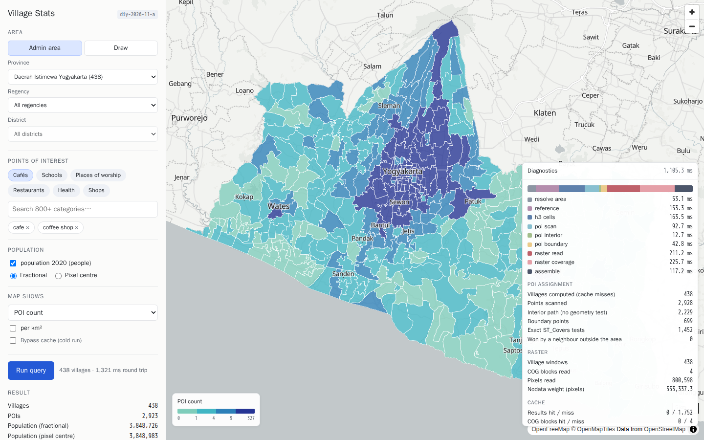
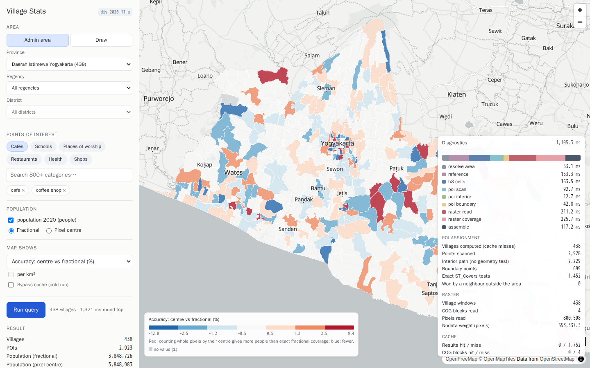
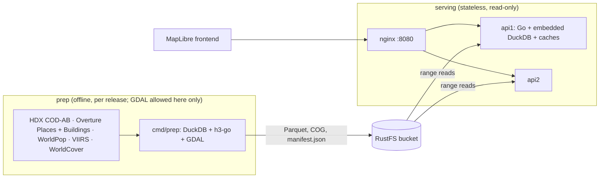

# Village Stats: on-demand zonal statistics for Indonesian villages

Choose an area (province, regency, district or a drawn polygon), POI categories and data layers (population, night lights, land cover, buildings). You get counts, sums, means and class shares for **every village (desa/kelurahan)** in that area, computed live from Parquet and Cloud-Optimized GeoTIFF files in object storage. A Go API embeds DuckDB; there is no serving database.



What it is built around:

1. **On-demand aggregation**: any category set, raster layer, statistic (sum, mean, class share), method and area per request.
2. **Correct raster numbers**: exact fractional pixel coverage per village (matches exactextract to 1.8e-8), shown next to naive pixel-centre counting, which is off by up to 12.8% for single villages.
3. **Fast village joins without a database**: an H3 interior/boundary split sends 76% of POIs to their village with no geometry test; only boundary points get an exact `ST_Covers`.
4. **Visible performance**: every response can explain where time went, including stages, cache hits, the POI split, raster blocks and DuckDB's own profile.

## Quickstart (≈1–5 minutes)

Needs Docker with Compose v2.20+.

```bash
docker compose up -d
```

Then open **http://localhost:8080**. The stack starts:
- RustFS (S3 API on `:9000`, console on `:9001`, login `rustfsadmin`/`rustfsadmin`)
- a one-shot **seed** that uploads the bundled DI Yogyakarta release (`sample/`)
- two API replicas (`:8081`, `:8082`)
- an nginx load balancer on `:8080`, which also serves the frontend

A no-cache build plus start-up took 61 s on a laptop with base images already pulled.

```bash
docker compose down        # stop (add -v to drop the RustFS volume)
```



## API

`GET /healthz` · `GET /v1/layers` · `GET /v1/areas` · `POST /v1/aggregate`. Full reference: [docs/api.md](docs/api.md); response schemas are in [schemas/](schemas/).

```bash
curl -s localhost:8080/v1/aggregate -H 'Content-Type: application/json' -d '{
  "area": { "regency_code": "3471" },
  "metrics": [
    { "id": "cafes", "type": "poi_count", "categories": ["cafe", "coffee_shop"] },
    { "id": "pop", "type": "raster_sum", "layer": "population_2020", "method": "fractional" }
  ],
  "diagnostics": true
}'
```

```json
{
  "release_id": "diy-2026-11-b",
  "boundary_version": "hdx-cod-ab-2020",
  "villages": [
    { "village_id": "3471010001", "village_name": "Gedongkiwo", "district_name": "Mantrijeron",
      "metrics": { "cafes": 13, "pop": 9981.6 }, "...": "..." }
  ],
  "summary": { "village_count": 45, "totals": { "cafes": 816, "pop": 378381.9 } },
  "diagnostics": { "total_ms": 54.2, "stages_ms": { "...": 0 }, "points_interior": 768,
                   "points_boundary_tested": 1162, "cache": { "result_hits": 0, "...": 0 }, "...": "..." }
}
```

- `area`: exactly one of `province_code`, `regency_code`, `district_code`, `geometry` (GeoJSON Polygon/MultiPolygon, lon/lat).
- Metric types: `poi_count`, `raster_sum`, `raster_mean` (e.g. night-light radiance), `raster_class_fraction` (e.g. share of land cover that is built-up), `building_count`, `building_area` ([docs/api.md](docs/api.md)).
- `method`: `fractional` (exact coverage) or `center` (pixel centre inside the village).
- `include_geometry: true` returns a GeoJSON FeatureCollection with the same properties.
- `Cache-Control: no-cache` bypasses every cache (the cold path); results are identical.
- Errors: 400 with field paths (e.g. `metrics[0].categories[1]`), 413 for areas over `MAX_VILLAGES`, 504 on timeout, 503 when storage is unavailable.

The response is abbreviated: values are real, other fields are elided.

## Architecture



A release (`releases/<id>/`) holds:
- `boundaries/villages.parquet`, Hilbert-sorted
- `village_h3/province_code=*/`, H3 res 10 cells tagged interior/boundary
- `pois/release=*/province_code=*/`, sorted by H3 cell
- `buildings/release=*/province_code=*/`: interior-cell buildings pre-summed per H3 cell, boundary-cell buildings as points ([docs/buildings.md](docs/buildings.md))
- `rasters/<layer>.tif` (COG) plus `.json` (kind, classes, scale)
- `categories.json`
- `manifest.json`: sources, checksums, row counts and all QC results

## Repository

```
cmd/api        serving binary            cmd/prep    release builder (download, transform, QC, upload)
cmd/seed       uploads sample/ releases  cmd/duckq   dev SQL tool on the pinned DuckDB
cmd/spike      storage/extension verification spike
internal/geom      planar kernel: covers, edge rule, clipping
internal/raster    fractional + centre coverage, weighted sums
internal/h3index   H3 interior/boundary classification
internal/prep      release pipeline + QC          internal/release  layout + manifest types
internal/query     engine: area resolution, POI split, raster path, caches, diagnostics
internal/api       HTTP handlers, validation, errors, gzip
web/               MapLibre frontend              schemas/   JSON Schemas (contract tests)
sample/            bundled DIY release            testdata/  fixtures + golden CSVs
deploy/            compose, Dockerfiles, nginx, k6 configs/ release configs  e2e/ Playwright smoke test
```

## Development

```bash
make help
```
```bash
make test
```
```bash
make lint
```
```bash
make api-local
```

`make test` runs the unit, golden, invariant and JSON Schema contract tests. `make lint` runs gofmt, vet and staticcheck. `make api-local` runs the API on `:8080` against `sample/`.

| Target | What |
|---|---|
| `make app-up` / `app-down` | Demo stack (same as `docker compose up -d --build`) |
| `make e2e` | Playwright smoke test against the stack; refreshes `docs/img/` |
| `make perf-baseline` | k6: latency scenarios + 5-minute, 20-user soak |
| `make prep-fixture` | Synthetic release, no downloads |
| `make prep-diy` | Real DI Yogyakarta release (needs `data/raw/`, see [docs/prep.md](docs/prep.md)) |
| `make prep-upload RELEASE=…` | Upload a built release to RustFS |
| `make golden-raster` | Regenerate exactextract/rasterstats reference CSVs |

CI ([.github/workflows/ci.yml](.github/workflows/ci.yml)) runs lint plus `go test -race` with GDAL, then brings up the compose demo and runs the Playwright smoke test. Go 1.26+, cgo; DuckDB 1.5.5 via `duckdb-go v2.10505.0` (pinned for the `cog` extension).

## Data sources and licenses

| Data | Source | License |
|---|---|---|
| Village boundaries, admin 0–4 (438 villages in the sample) | [HDX COD-AB Indonesia](https://data.humdata.org/dataset/cod-ab-idn): BPS, WFP, OCHA ROAP; boundaries 2020 | **CC BY-IGO** |
| Points of interest | [Overture Maps](https://overturemaps.org) Places, release 2026-10-21.0 | **CDLA-Permissive-2.0** (some sources Apache-2.0) |
| Population 2020, constrained, 100 m | [WorldPop](https://www.worldpop.org), University of Southampton | **CC BY 4.0** |
| Building footprints | [Overture Maps](https://overturemaps.org) Buildings, release 2026-10-21.0 (OpenStreetMap, Microsoft, Google Open Buildings) | **ODbL-1.0** |
| Night lights 2023, 500 m | Annual VIIRS VNL V2 (Elvidge et al. 2021, EOG, Colorado School of Mines), [OpenGeoHub COG series](https://zenodo.org/records/17294744) | **CC BY 4.0** |
| Land cover 2021, 10 m (aggregated to ~28 m) | [ESA WorldCover](https://esa-worldcover.org) v200 | **CC BY 4.0** |
| Basemap (frontend) | [OpenFreeMap](https://openfreemap.org), © OpenStreetMap contributors | ODbL |

Every release's `manifest.json` records each source's URL, version, license and sha256, and the frontend footer shows them. Village codes are BPS codes (HDX P-codes without the `ID` prefix). The boundaries predate the 2022 Papua split; see [docs/design.md §7](docs/design.md).

## Documentation

| Doc | Contents |
|---|---|
| [docs/design.md](docs/design.md) | **Trade-offs**: on-demand vs precompute, file layout, H3 split, fractional coverage, replicas/memory, when PostGIS is better |
| [docs/spikes.md](docs/spikes.md) | Verification spikes: pinned versions, boundary source decision, cog/httpfs/profiling findings |
| [docs/prep.md](docs/prep.md) | Release pipeline, adapters, QC, H3 resolution calibration |
| [docs/query.md](docs/query.md) | Engine, area resolution, POI split, golden and invariant tests |
| [docs/raster.md](docs/raster.md) | Raster path, statistics (sum, mean, class share), layer kinds, cog behaviour, exactextract/rasterstats golden results |
| [docs/buildings.md](docs/buildings.md) | Building layer: point-on-surface rule, H3-split storage, query, tests |
| [docs/api.md](docs/api.md) | HTTP API, errors, resilience checks |
| [docs/caching.md](docs/caching.md) | Caches, diagnostics, performance baseline |
| [docs/frontend.md](docs/frontend.md) | Frontend, manual checklist, Playwright smoke test |

## License

The code is released under the [MIT License](LICENSE). Data keeps its own licenses: the bundled sample in `sample/` and any release built by prep are covered by the source licenses listed under [Data sources and licenses](#data-sources-and-licenses) (CC BY-IGO, CDLA-Permissive-2.0, CC BY 4.0, ODbL-1.0), which require attribution; ODbL also requires share-alike for derived databases.
