# Gallery

Every data layer of the DI Yogyakarta sample release (`diy-2026-11-b`, 438 villages) as it appears in the web UI. Two kinds of view:

- **Choropleths**: per-village results of one `POST /v1/aggregate` for the whole province (exact fractional pixel coverage for rasters, the H3 split for points and buildings).
- **Live tiles**: the layers themselves, drawn from tiles DuckDB renders per request (`ST_AsMVT` over Parquet, the `cog` extension for rasters; docs/tiles.md). The panel's last line shows the live tile count, cache hits and DuckDB time per tile.

The screenshots are produced by `e2e/gallery.mjs` against the Docker demo stack:

```bash
make app-up
```

```bash
make gallery
```

Images are 1440×900 JPEGs in `docs/img/gallery/`. Tile shots were taken on freshly restarted replicas, so their timings are cold (Docker Desktop, Apple Silicon); a repeat is served from the tile cache in ~1 ms.

## Per-village results (choropleths)

### Population (WorldPop 2020)

`raster_sum`, fractional coverage. Province total 3,848,726 people.

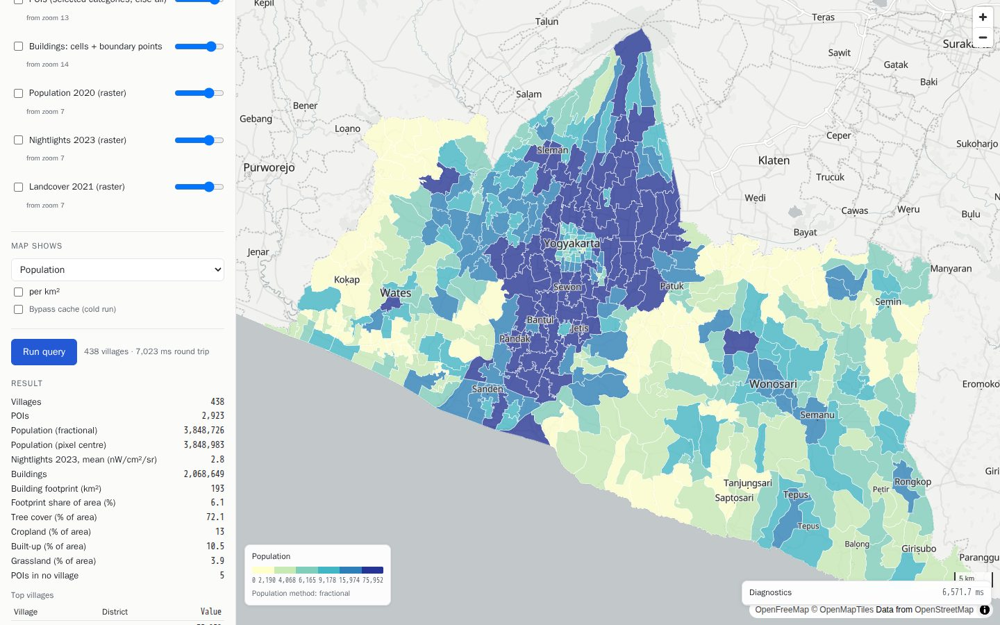

### Night lights (VIIRS 2023)

`raster_mean`: the coverage-weighted mean radiance of each village, in nW/cm²/sr (see the units caveat in docs/raster.md). The Yogyakarta conurbation and Wonosari stand out; the karst south (Gunung Kidul) is dark.

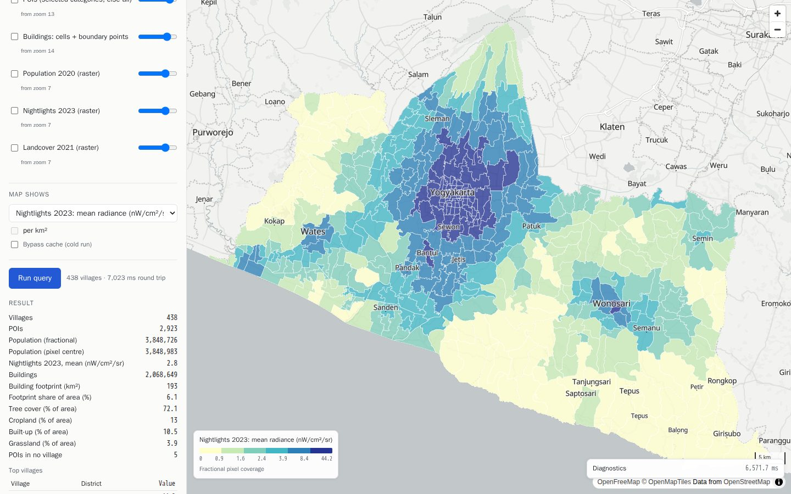

### Land cover (ESA WorldCover 2021): dominant class

One `raster_class_fraction` per class; each village takes the colour of its largest class. Tree cover dominates 311 villages, built-up 84 (the city and Wates, Bantul, Wonosari centres), cropland 41. Province shares: tree cover 72%, cropland 13%, built-up 10.5%.

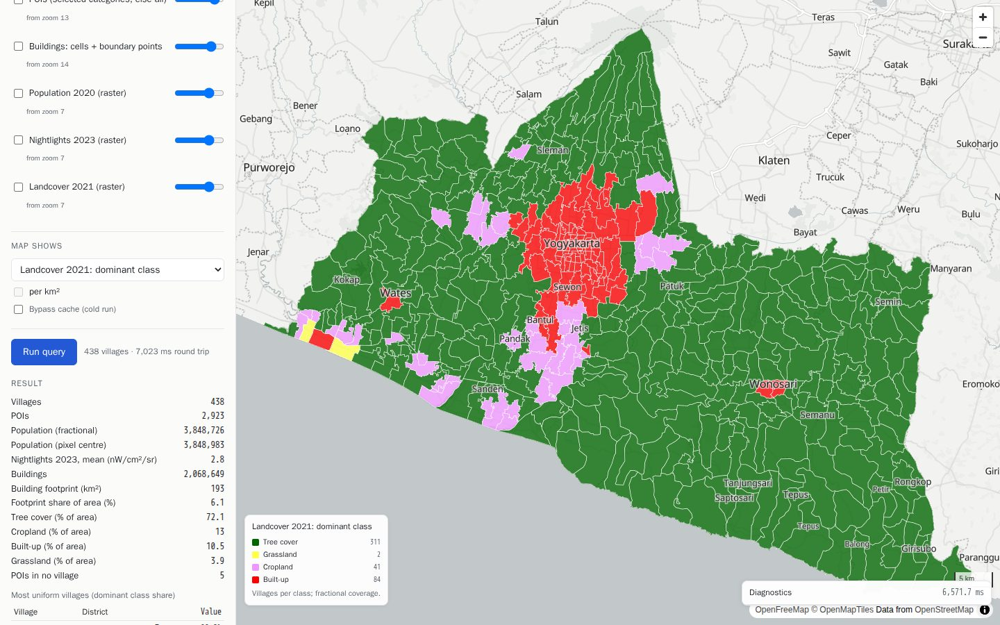

### Land cover: built-up share

The same request, viewed as one class's share of each village's area.

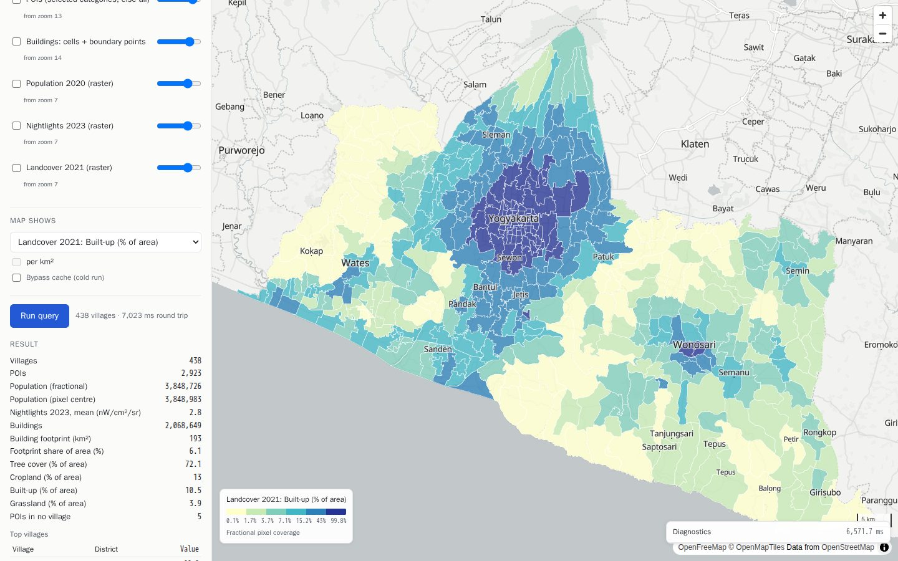

### Buildings: footprint share of village area

`building_area / area_m2`. From over 50% in the city core to under 1% in the south; 2.07 M buildings and 193 km² of footprint (6.1% of DIY).

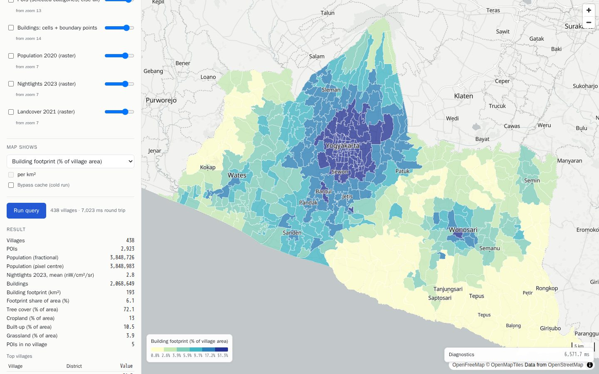

### People per building

Population (WorldPop) divided by building count (Overture): two independent sources combined per village in one request. Villages range from under 1 to about 6. Values below 1, common in rural Gunung Kidul and Kulon Progo, most likely reflect sheds and outbuildings in the footprint data rather than empty houses, so read this as a data-combination example, not a housing statistic.

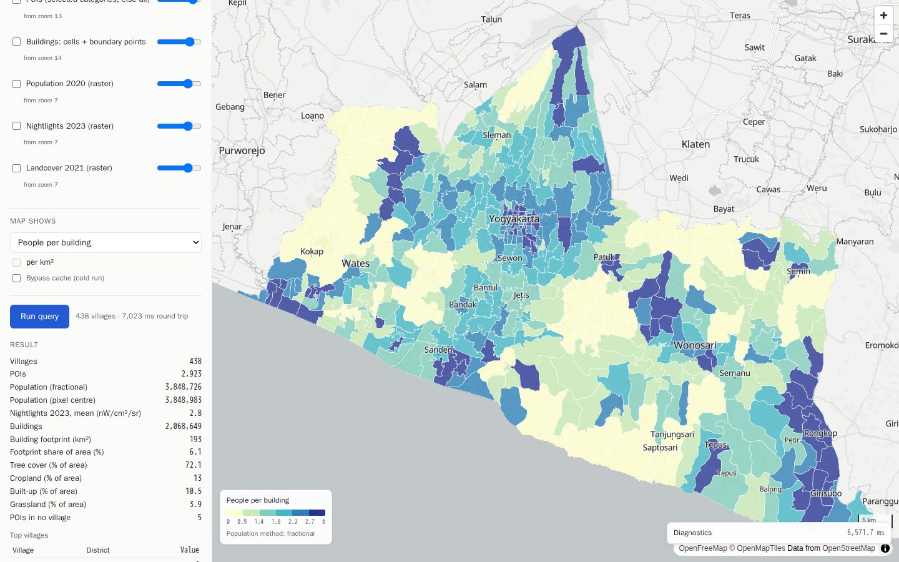

## The layers themselves (live DuckDB tiles)

### Land cover raster

PNG tiles from the WorldCover COG through the `cog` extension, nearest pixel, class colours from the manifest; DuckDB-generated village outlines on top.

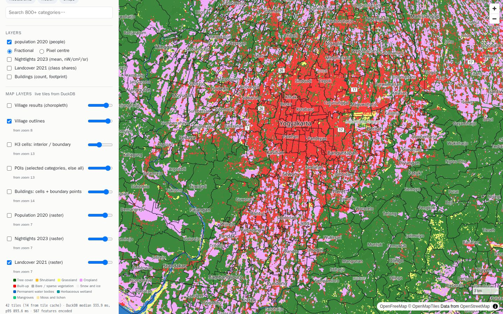

### Night-light raster

Ten classes at deciles of the valid values > 0, computed once per layer by DuckDB (`quantile_cont` over the whole raster); the legend in the panel comes from `/v1/tiles/raster/{layer}/legend`.

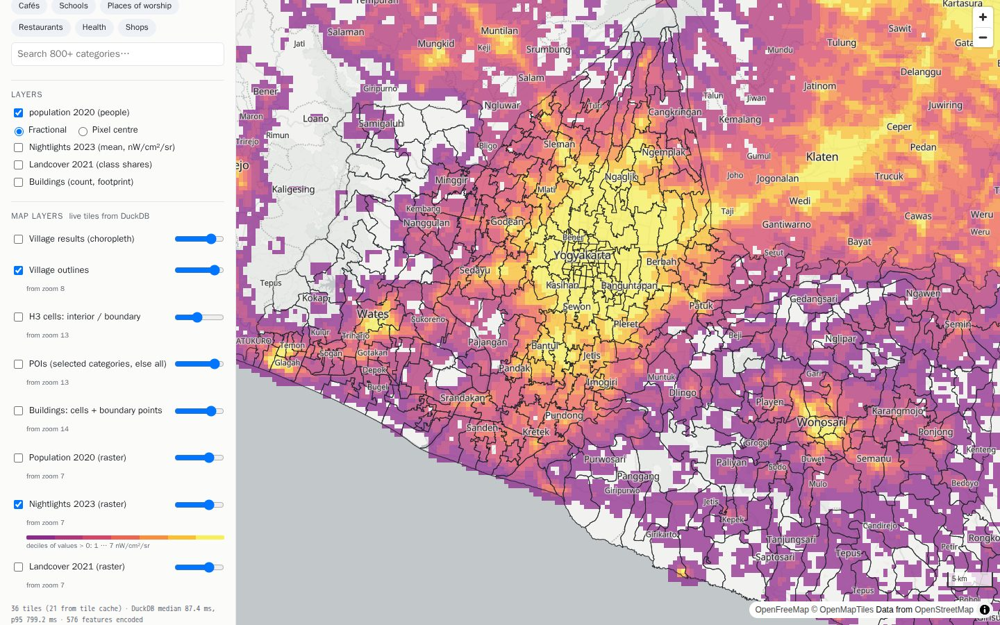

### Population raster

The 3″ (~92 m) WorldPop grid behind the population numbers, at street scale.

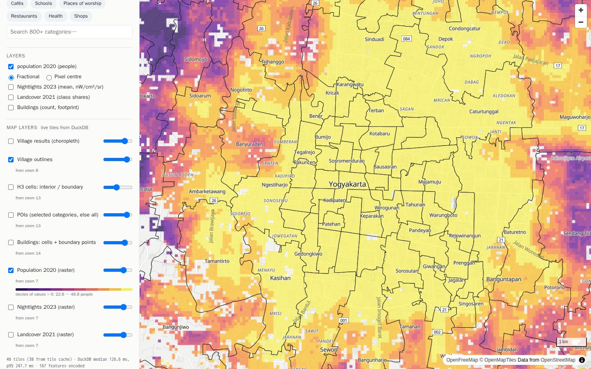

### The H3 interior/boundary split

`village_h3` drawn with `h3_cell_to_boundary_wkb`: green **interior** cells lie wholly inside one village, so points in them are assigned with no geometry test; red **boundary** cells, along village borders, are the only places an exact `ST_Covers` runs (docs/design.md §3). Overlapping red cells are claimed by several villages.

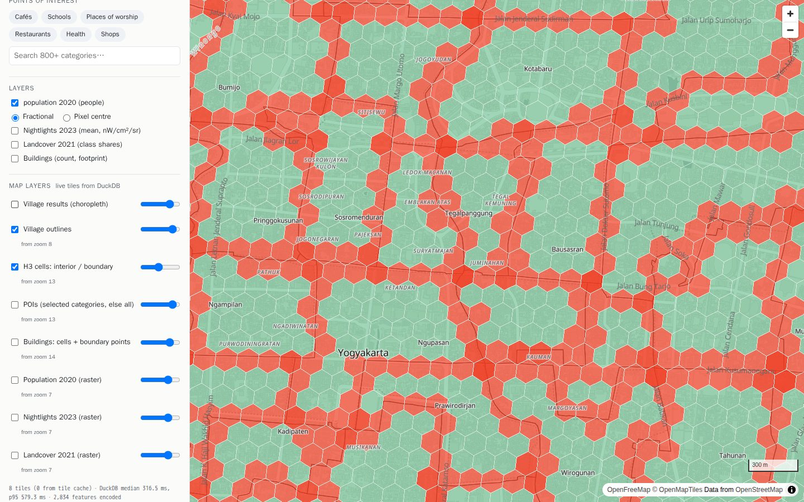

### Buildings as stored

The storage design made visible (docs/buildings.md): **hexagons** are interior cells whose buildings prep pre-summed (shaded by count), **dots** are the buildings in boundary cells kept as points for the exact test.

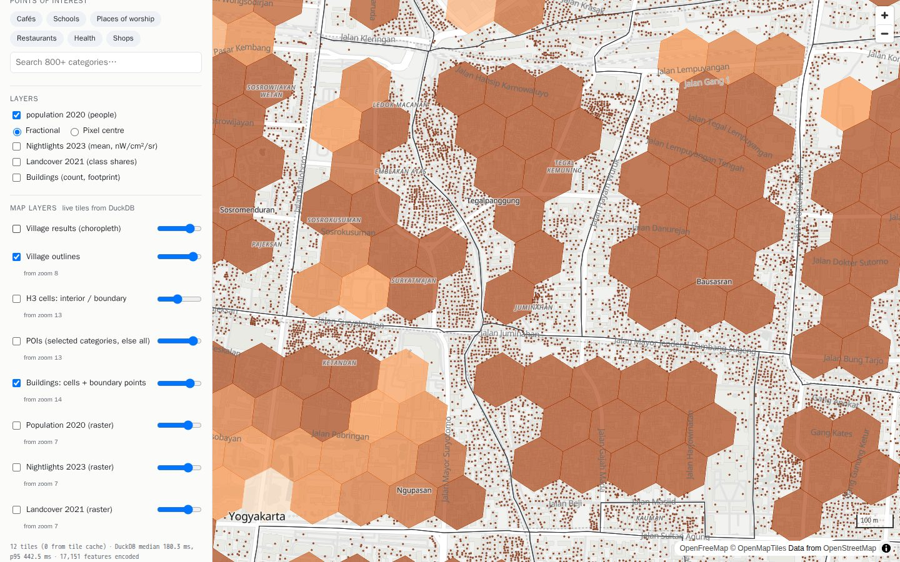

### Points of interest

All Overture places in central Yogyakarta (the selected categories filter this layer when any are chosen, `?categories=` pushed into the Parquet scan).

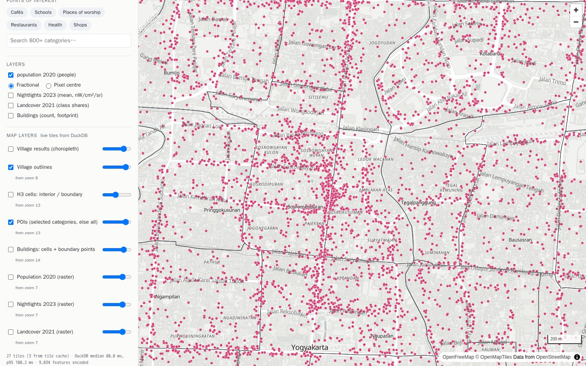
