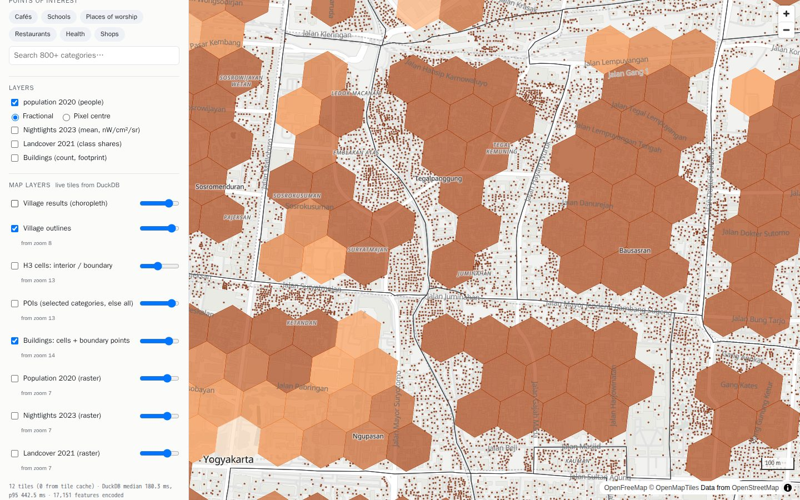

# Live map tiles

Every layer in a release can be drawn on the map, not only the per-village aggregates. Nothing is pre-rendered: **each tile is made per request by DuckDB from the same Parquet and COG files the aggregation reads**. Code: `internal/query/tiles.go`, handlers in `internal/api/server.go`, frontend "Map layers" panel in `web/app.js`.

| Endpoint | Returns |
|---|---|
| `GET /v1/tiles/{layer}/{z}/{x}/{y}.mvt` | Mapbox Vector Tile, encoded by DuckDB `ST_AsMVT` |
| `GET /v1/tiles/raster/{layer}/{z}/{x}/{y}.png` | 256×256 PNG; pixels read through the `cog` extension |
| `GET /v1/tiles/raster/{layer}/legend` | how a raster layer is coloured (breaks or classes) |

`GET /v1/layers` lists them under `tiles` (layer ids, min zooms, URL templates). Tiles use the XYZ scheme (Web Mercator).

Screenshots of every layer: [gallery.md](gallery.md).



## Vector layers

| Layer | MVT layer(s) | From | Min zoom | DuckDB showcase |
|---|---|---|---|---|
| `villages` | `villages` | `boundaries/villages.parquet` | 8 | bbox-struct pruning, `ST_SimplifyPreserveTopology` to half a tile pixel, `ST_Transform` to EPSG:3857 |
| `h3` | `h3` (`cell_type` interior/boundary) | `village_h3/*` | 13 | `h3_cell_to_boundary_wkb` turns cell ids into hexagons: the interior/boundary split made visible |
| `pois` | `pois` (`name`, `category`) | `pois/*` | 13 | `?categories=a,b` filter pushed into the Parquet scan; `lon`/`lat` min/max stats prune row groups |
| `buildings` | `building_cells` (pre-summed interior cells as hexagons: `buildings`, `area_m2`) and `building_points` (boundary-cell buildings) | `buildings/*` | 14 | two MVT layers from two queries, concatenated (MVT layers are protobuf fields); integer `x_e7`/`y_e7` bounds prune row groups |

Every vector tile is one statement per MVT layer of this shape:

```sql
SELECT ST_AsMVT(f, 'pois', 4096, 'geom' ORDER BY f::VARCHAR), count(*) FROM (
  SELECT name, category,
    ST_AsMVTGeom(ST_Transform(geometry, 'EPSG:4326', 'EPSG:3857', true),
                 ST_Extent(ST_TileEnvelope(14, 13214, 8548)), 4096, 64, true) AS geom
  FROM read_parquet([...province partitions...])
  WHERE lon BETWEEN … AND lat BETWEEN …          -- tile bounds + 64-unit buffer
    AND category IN (SELECT unnest(['cafe', 'coffee_shop']))
) f WHERE geom IS NOT NULL
```

- **Deterministic bytes.** A parallel scan feeds features to the aggregate in a different order each run, so the same tile differed byte-for-byte between replicas. The ordered aggregate (`ORDER BY f::VARCHAR`, the whole feature as text) fixes that for ~10% extra time; both replicas now return identical tiles.
- Hexagons are selected by their centre, so their filter box is grown by two H3 edge lengths at the release resolution. Without that, cells crossing a tile edge left visible seams.
- Partitions are every manifest artifact matching the layer's path pattern, so tiles work for any set of provinces.
- Features smaller than one tile unit are generalised away (the 55 m fixture triangle V005 is absent at z8 and present at z14), as in any tile pipeline.

## Raster layers

1. The tile's lon/lat window is snapped to raster pixels, and the COG blocks under it are read with `RS_BandAsArray` — **the same block reader and block cache as raster aggregation** (docs/raster.md), so tiles and zonal statistics warm each other.
2. Each output pixel's centre is projected back to lon/lat and takes the nearest raster pixel. No resampling of class codes.
3. Colours: categorical layers use their class colours from the manifest. Continuous layers use 10 classes at **deciles of the valid values > 0, computed once per layer by DuckDB** (`quantile_cont` over `unnest(RS_BandAsArray(…))` of the whole raster); 0 and nodata are transparent. `…/legend` returns the breaks and colours.
4. Below zoom 7 tiles are empty (a whole-province window is a few million pixels; national rasters would need overview reads first).

## Caching and timing

- Encoded tiles are cached per replica (`TILE_CACHE_ENTRIES`, default 4,096; a hit is ~1 ms). A request with `Cache-Control: no-cache` bypasses it (the UI's "Bypass cache" checkbox).
- Responses carry `Cache-Control: no-cache`: map clients keep tiles in memory anyway, and this stops browsers silently reusing a tile, so the timing shown is always the request's own. (A first version fetched with `cache: 'no-store'`; Chrome then sends `Cache-Control: no-cache` itself, so the UI never hit the server tile cache.)
- Every tile carries `Server-Timing`: `duckdb;dur=<ms>, features;desc="<n>"` when computed, `cache;desc="hit"` when served from the tile cache, `cache;desc="blocks"` when a raster tile was drawn only from already-decoded COG blocks (no cog read), `empty;desc="no data"` when no query was needed (below the layer's min zoom, or a raster tile outside the raster). The UI counts empty tiles separately so they do not pull the DuckDB median to 0.
- The frontend loads tiles through a `duck://` MapLibre protocol: a main-thread `fetch` that reads that header (MapLibre fetches vector tiles in a worker, where the page cannot see timing), so the "Map layers" panel shows live tile counts, DuckDB median/p95 ms and features encoded.

## Measured (DIY sample, local files, Apple Silicon, cold)

| Tile | DuckDB | Size (gzip) | Features |
|---|---|---|---|
| `villages` z9 (whole province) | ~165 ms | 61 KB | 240 |
| `villages` z13 | 19 ms | 7 KB | 32 |
| `h3` z13, central Yogyakarta | 71 ms | 34 KB | 2,339 |
| `pois` z14 (all categories) | 13–19 ms | 47–88 KB | 1,755–3,778 |
| `pois` z13, `categories=cafe,coffee_shop` | 14 ms | | 428 |
| `buildings` z14 | 40–55 ms | 61–115 KB | 4,837–9,803 |
| `raster/landcover_2021` z12 / z9 | 15 / 110 ms | 21 / 9 KB | |

A tile cache hit is ~1 ms.

## Tests

- `TestParseTileAndBounds`: tile parsing and bounds against orb's independent `maptile`.
- `TestVectorTilesFixture`: decodes DuckDB's MVT with orb's decoder. Villages present (and V005 generalised away at z8, present at z14); POIs in a z14 tile are exactly the fixture POIs inside the tile and buffer, filtered by category, at their positions within two tile units; buildings give both MVT layers; H3 tiles have interior and boundary cells; the tile cache returns identical bytes; bad layers and categories are `ErrBadTile`.
- `TestVectorTilesDeterministic`: five cold renders of each vector layer are byte-identical.
- `TestRasterTilesFixture`: land-cover PNG pixels have their class colours on each side of the fixture's class boundary; tiles outside the raster are transparent; continuous breaks are increasing and inside the fixture's value range.
- `TestTileEndpoints`: content types, `Server-Timing`, cache hit on repeat, valid PNG, legends, 400s for bad tiles.
